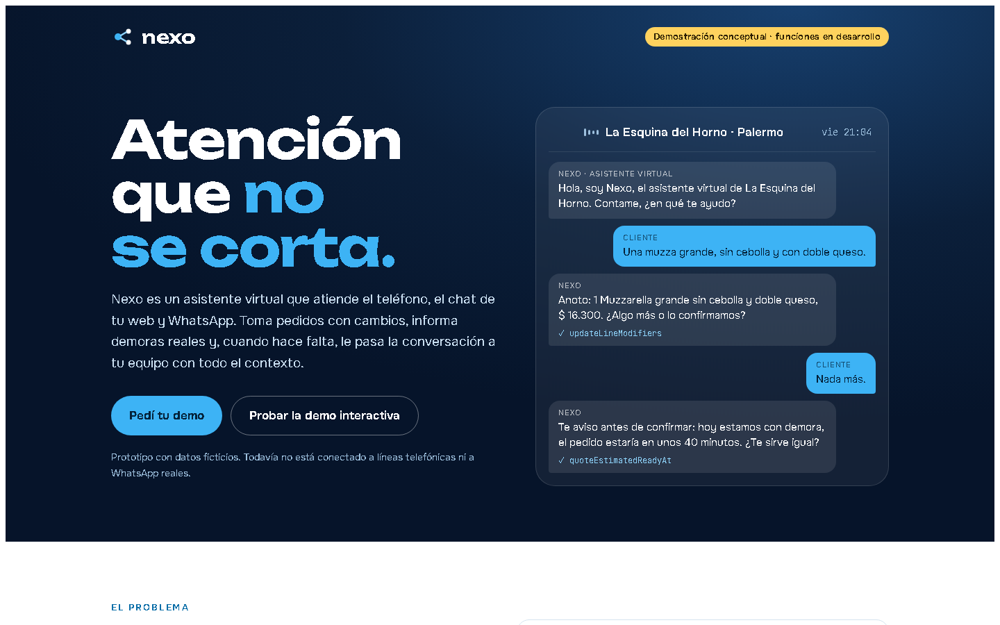
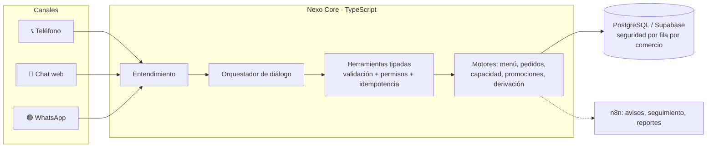

  

<h1 align="center">Nexo</h1>

<b>Atención que no se corta.</b> Un asistente de IA que atiende el teléfono, el chat de la web y WhatsApp de un comercio.

  <a href="https://ttom0001.github.io/nexo-vitrina/"><b>🔗 Ver la landing en vivo</b></a>

  
  
  
  
  
  
  

## La idea

Trabajé atendiendo gente en hora pico, en una central de taxis y en un comercio, y sé lo que pasa cuando suena el teléfono y no hay manos: se pierden pedidos, el cliente se enoja y nadie se entera.

Nexo es mi respuesta a eso: un asistente que atiende por **teléfono, chat web y WhatsApp**, toma pedidos con cambios ("una muzza grande, sin cebolla y con doble queso"), avisa demoras reales antes de confirmar y, cuando algo se complica, **le pasa la conversación a una persona con todo el contexto**.

## Qué hace hoy

- 💬 **Conversa y toma pedidos** con modificadores, calcula precios y confirma.
- ⏱️ **Avisa demoras reales** según la capacidad de la cocina antes de cerrar el pedido.
- 🙋 **Deriva a un humano** cuando no puede resolver, sin que el cliente tenga que repetir nada.
- 🏪 **Un mismo núcleo para distintos rubros**: restaurante, gimnasio y tienda funcionan sobre la misma base.
- 🍕 **Nexo Pedidos**: automatización para pizzerías y hamburgueserías con reglas, servidor y flujos en n8n.
- 🧪 **Centro de pruebas**: simula llamadas y WhatsApp a la vez, con prueba de carga ("un sábado a la noche de punta a punta").

## Cómo lo pensé

La regla más importante del proyecto: **el modelo de lenguaje no decide operaciones**. Entiende lo que dice el cliente y propone; el backend valida comercio, identidad, permisos, capacidad e idempotencia antes de ejecutar nada. Todo lo que Nexo le afirma al cliente sale de lo que devolvió una herramienta, no de lo que "se imagina" la IA.

## De lo que estoy orgulloso

- **Multi-comercio desde el día uno.** Cada fila de la base pertenece a un comercio y la seguridad por fila (RLS) impide que uno vea datos de otro. Lo verifico con **28 pruebas de seguridad** sobre PostgreSQL 16 real en Docker.
- **80 pruebas automatizadas**: unitarias, de escenarios completos, de automatización y de "personalidad" del asistente.
- **Honestidad con lo que está y lo que no.** Escribí un documento de "real vs. simulado" para que nadie confunda una demo con un producto terminado.
- **Pensé el producto entero**, no solo el código: arquitectura, riesgos y costos, landing, guion de venta y video promocional.

## Estado real

Etapa 1 terminada (arquitectura + primer bloque funcionando con datos ficticios). Lo que **ya funciona**: la lógica de negocio, las herramientas, el esquema con seguridad y la demo. Lo que **todavía está simulado** hasta tener credenciales: telefonía, WhatsApp, sistemas de gestión externos y el modelo de lenguaje.

Próximo paso: panel en Next.js con login, guardando conversaciones, pedidos y tickets en las tablas que ya están creadas.

## ¿Y el código?

El repositorio de Nexo es privado mientras está en desarrollo. Con gusto lo muestro y lo explico en una entrevista.

---

**Tomás Frem** · Tolhuin, Tierra del Fuego · [LinkedIn](https://www.linkedin.com/in/tomas-frem) · [Todos mis proyectos](https://github.com/ttom0001)
